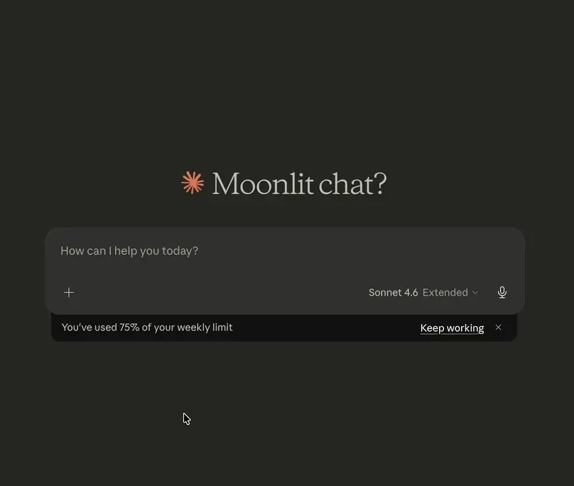
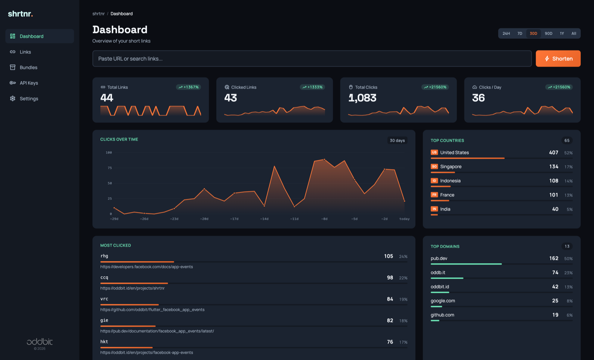
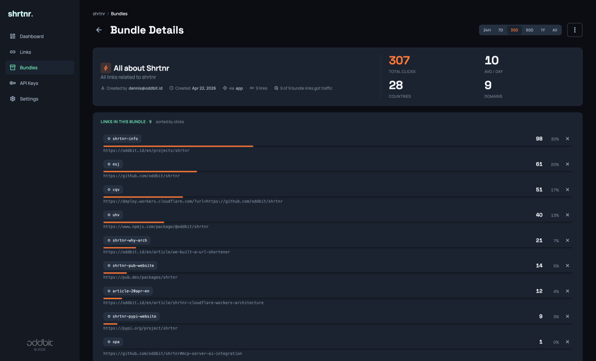
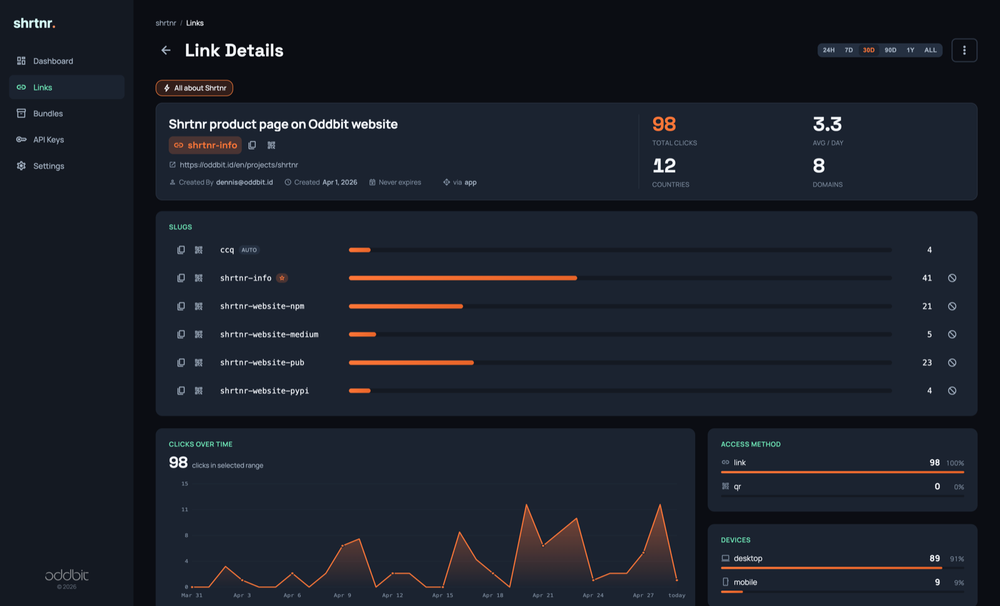
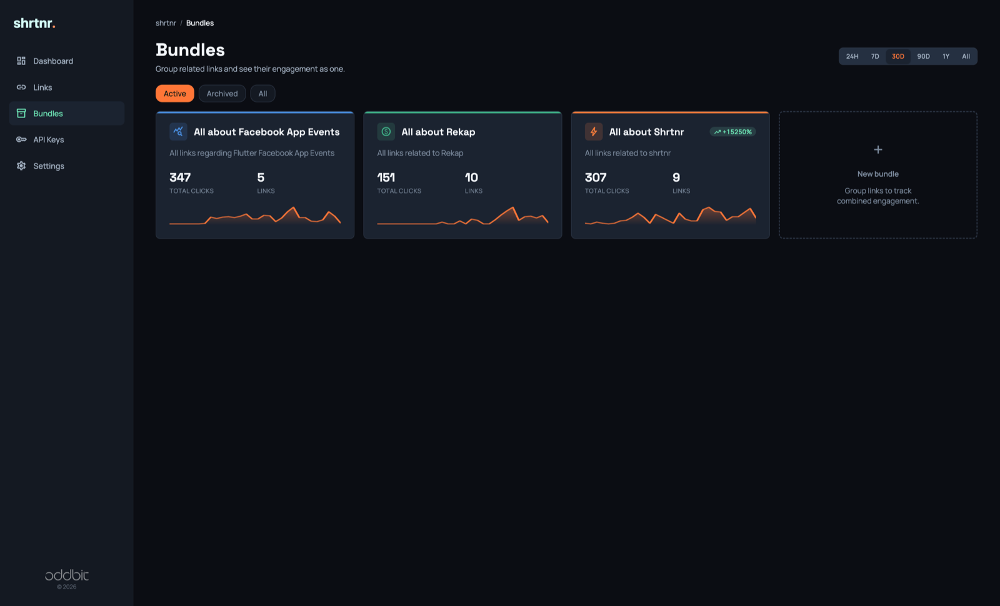
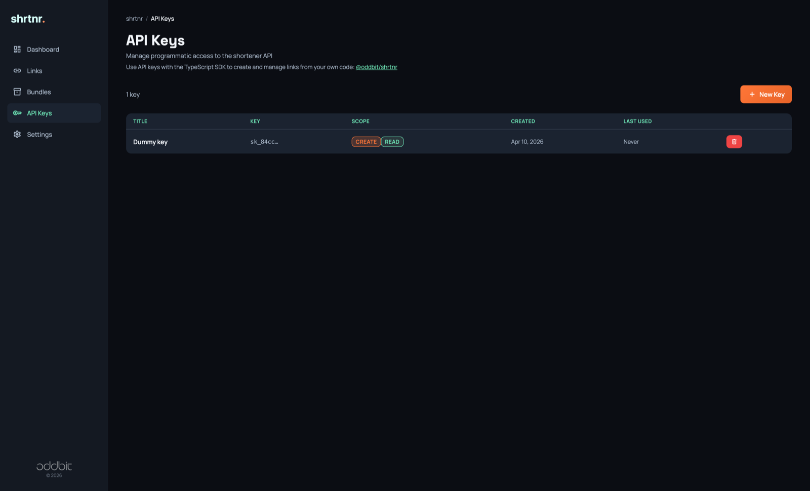

# A programmable link layer for apps, teams and AI agents

[](https://www.npmjs.com/package/@oddbit/shrtnr)
[](https://pypi.org/project/shrtnr/)
[](https://pub.dev/packages/shrtnr)

shrtnr is a self-hosted URL shortener you drive from code and from AI assistants, not only from a dashboard. Every deployment ships a REST API with an OpenAPI spec, typed SDKs on npm, PyPI and pub.dev, and a native MCP server. Claude, Copilot and any other MCP client connect to it through OAuth on Cloudflare Access. Links belong to their creator, several slugs can point at one destination, and bundles roll a campaign's clicks into one report. It runs on Cloudflare Workers and D1, inside the free tier.

[](https://oddb.it/shrtnr-deploy-top)



## Who this is for

- **Teams that need per-person permissions, not a shared password.** Cloudflare Access signs every teammate in with their own identity. Links and bundles record their creator, and only the creator can edit, disable or delete them. Everyone can read everything. API keys are issued per person and act as that person. [Permission model](docs/access-control.md#permission-model).
- **Developers integrating links into an app.** A REST API documented by an OpenAPI 3.1 spec, with a live reference at `/_/api/docs` on your deployment. Typed SDKs for TypeScript, Python and Dart, generated from that spec. Bearer keys with `read` and `create` scopes. Link creation is idempotent. One endpoint returns QR codes as SVG.
- **Anyone whose AI assistant should create and manage links.** The MCP server at `mcp.<your-domain>` exposes tools to shorten URLs, attach slugs, group links into bundles and query analytics. Each tool is annotated as read-only, idempotent or destructive. OAuth on Cloudflare Access authenticates it, so no shared token goes into a config file. [MCP server](docs/mcp.md).

## Features

What sets it apart:

- **Native MCP server.** Tools for links, slugs, bundles, QR codes and analytics, served from the same Worker. OAuth through Cloudflare Access Managed OAuth; every tool call runs as the signed-in user. Analytics tools echo the time range they used and apply the user's own bot and self-referrer filters. [Setup and tool reference](docs/mcp.md).
- **Bundles with combined analytics.** Group the links of one campaign, launch or project. A bundle reports total clicks, a timeline, countries, referrers, devices, browsers and each link's share of the total, over any time range. A link can belong to several bundles. Archive a bundle when the campaign ends.
- **Several slugs per link.** One destination answers on a random slug and any number of custom slugs, for example one per channel. Each slug tracks its own clicks. Disable or enable a slug on its own, or pick the primary one.
- **Ownership and permissions.** Identity comes from Cloudflare Access. Creators own their links and bundles. Anyone can read, and anyone can add a slug to a link or a link to a bundle. Settings such as theme, language and default range are stored per user. [Access control](docs/access-control.md).
- **Typed SDKs** for TypeScript ([`@oddbit/shrtnr`](https://www.npmjs.com/package/@oddbit/shrtnr)), Python ([`shrtnr`](https://pypi.org/project/shrtnr/)) and Dart/Flutter ([`shrtnr`](https://pub.dev/packages/shrtnr)). CI pins each SDK to the hash of the OpenAPI spec it was generated from, so an API change cannot ship without the SDKs.
- **REST API** with an OpenAPI 3.1 spec at `/_/api/openapi.json` and an interactive reference at `/_/api/docs`. API keys are hashed at rest and scoped to `read`, `create` or both.

The rest of the shortener:

- **Click analytics** by country, referrer URL and referrer host, device type, operating system, browser, and QR scan versus link click. The timeline adapts its buckets to the range (24 hours to all time). Bots and self-referrers are filtered out by default, per user.
- **Custom slugs and short random slugs.** Random slugs start at 3 characters from a 32-character alphabet: 32,768 combinations at that length. Custom slugs like `/spring-sale` sit alongside them.
- **Link expiry.** Set `expires_at` on creation or later. An expired link answers 404.
- **Disable instead of delete.** A link or slug with recorded clicks can only be disabled, never deleted, so no click history is lost by accident. Disabling is reversible.
- **Idempotent creation.** Shortening a URL that already has a link returns the existing link, after trailing-slash normalization. Pass `allow_duplicate` to force a second one.
- **Labels from the page title.** A link created without a label gets the destination page's title, fetched in the background. Private and internal hosts are refused.
- **QR codes** as SVG for any slug, from the admin UI, the API, the SDKs and MCP. Scans are tracked separately from link clicks.
- **Edge redirects.** Workers KV caches slug lookups in front of D1. Click recording runs after the redirect is sent.
- **Admin dashboard** in every language under [`src/i18n/`](src/i18n/) and every theme in `THEMES` ([`src/constants.ts`](src/constants.ts)), with per-link and per-bundle analytics, API key management and settings.
- **Browser extension** for Chrome and Firefox that shortens the current tab against your own deployment. Source and store status in [browser-extensions/README.md](browser-extensions/README.md).
- **One-click deploy** provisions the database and KV namespace. The Worker applies migrations on its first request.

Not yet: password-protected links, link import and export, routing by device or country, tags, social preview overrides, click webhooks, and a read-only MCP scope. Every click stores its UTM parameters, but the dashboard does not report them yet.

## Screenshots

| Dashboard | Bundle analytics | Link analytics |
|---|---|---|
|  |  |  |

| Bundles | API keys |
|---|---|
|  |  |

<p align="right"><a href="https://oddb.it/shrtnr-info">See it in action</a></p>

## Deploy

### One-click

Click **Deploy to Cloudflare**. Cloudflare forks the repo into your GitHub or GitLab account, provisions the D1 database and KV namespace that `wrangler.jsonc` declares, and deploys the Worker through [Workers Builds](https://developers.cloudflare.com/workers/ci-cd/builds/).

[](https://oddb.it/shrtnr-deploy-howto)

The Worker creates its own schema on the first request. No command runs afterwards. To confirm the deploy:

1. Open `https://<your-worker>.workers.dev/_/admin/dashboard`. This first visit creates the schema. Nothing protects the Worker yet, so the page answers with the Access setup steps.
2. Open `https://<your-worker>.workers.dev/_/health`. It answers `"schema": { "ready": true }`.
3. Follow [Protect the admin UI](#protect-the-admin-ui): enable Access on the `workers.dev` URL in one click, then store the `ACCESS_AUD` and `ACCESS_JWKS_URL` secrets.
4. Reload the dashboard, sign in through Access and create a link.

Every later push to your fork redeploys through Workers Builds. The Worker applies any new migration on the first request after the deploy. [Database schema](#database-schema) covers the mechanism and what to check when it fails.

### Manual

```bash
git clone https://github.com/oddbit/shrtnr
cd shrtnr
yarn install
yarn wrangler-login
yarn deploy
```

`wrangler.jsonc` declares the D1 database and KV namespace by name only. The first `yarn deploy` creates both in your account through wrangler's [resource provisioning](https://developers.cloudflare.com/workers/wrangler/configuration/#automatic-resource-provisioning). Later deploys link to them by binding name. Wrangler also writes the new IDs into your local `wrangler.jsonc`. Discard that change: the IDs are specific to your account and the deploy works without them.

The first request creates the schema. To apply it from your terminal ahead of that request, run `yarn db:migrate:remote`. The Worker and the CLI record their work in the same table, so either can go first.

### Continuous deployment

Cloudflare [Workers Builds](https://developers.cloudflare.com/workers/ci-cd/builds/) redeploys the Worker on every push to your production branch. Schema changes need no separate step: the deployed Worker carries its migrations and applies the pending ones on the first request.

Build settings, under **Workers & Pages > shrtnr > Settings > Build** in the dashboard:

| Field | Value |
|---|---|
| Build command | empty |
| Deploy command | `yarn deploy` (or `npx wrangler deploy`) |
| Version command | `npx wrangler versions upload` |

A fork created by the deploy button gets these from `package.json`. Both commands link to the Worker's existing KV namespace and D1 database by the binding names in `wrangler.jsonc`.

**Remove a `bash scripts/resolve-bindings.sh && ...` prefix if a field still carries one.** Projects set up before this repo dropped its id placeholders may have it. The script no longer exists, and the build fails with "No such file or directory".

To apply migrations before the Worker takes traffic, pick one of two optional routes:

- **GitHub Actions.** `.github/workflows/migrate.yml` runs `wrangler d1 migrations apply` after Cloudflare's check suite succeeds on `main`. Add two repository secrets under **Settings > Secrets and variables > Actions**: `CLOUDFLARE_API_TOKEN` with **Workers Scripts: Edit** and **D1: Edit**, and `CLOUDFLARE_ACCOUNT_ID`. A fork created by the deploy button adds the workflow and secrets the same way.
- **Workers Builds deploy command.** Set the deploy command to `npx wrangler d1 migrations apply DB --remote && npx wrangler deploy`. Workers Builds creates its own token with Workers Scripts, KV and R2 edit rights. [Its documented permission list](https://developers.cloudflare.com/workers/ci-cd/builds/configuration/) does not include D1. Add **D1: Edit** to that token under **My Profile > API Tokens** first, or the migration step fails with an authentication error.

### Database schema

Migrations live in `migrations/*.sql`. `yarn migrations:bundle` (run for you by `yarn dev`) writes them into `src/db/migrations.generated.ts`, which ships inside the Worker. The vitest suite fails when the two disagree: add a migration, run the bundler, commit both.

On an isolate's first request, the Worker applies every migration not yet recorded in D1's `d1_migrations` table. `wrangler d1 migrations apply` uses the same table and file names. Each migration runs as one transaction with its bookkeeping row, so isolates racing on a fresh deploy apply each migration once. After that first request the check is a settled promise. A fresh isolate reads the recorded schema version from KV before it touches D1, so redirects pay nothing for it.

Two routes report on the schema. Neither changes it on a GET:

| Route | Reports |
|---|---|
| `GET /_/health` | `schema.version` (what this build expects), `schema.applied` (the last recorded migration) and `schema.ready`. A database no request has reached yet reports `ready: false` with 200. After a failed migration attempt: 503 with `"status": "degraded"` and the error. |
| `GET /_/setup` | Applied and pending migrations. `POST /_/setup` retries the migration at once. |

Both `/_/setup` routes require a Cloudflare Access identity once `ACCESS_AUD` is set. Before that, they are rate-limited to ten requests a minute per client.

After a failed migration, the Worker waits 30 seconds before a request triggers another attempt. A migration that fails against live data costs one failed statement batch per half minute, not one per request. What visitors see depends on the database:

- **No schema yet** (a fresh deploy): every route answers a 503 page that names the failing migration and the database error. The usual cause is a Worker without a D1 binding named `DB` (check **Settings > Bindings** in the dashboard).
- **An older schema in place** (an upgrade whose new migration fails): short links keep redirecting, since they read existing tables. The admin pages, the API and the MCP endpoint answer the 503 page, and `/_/health` reports degraded. The operator sees the failure; visitors do not.

## Protect the admin UI

The admin pages open only behind [Cloudflare Access](https://developers.cloudflare.com/cloudflare-one/applications/). Access supplies the login and the per-user identity behind ownership, API keys and settings. The Worker verifies every Access JWT itself.

1. Enable Access on the `workers.dev` URL in one click, or add a self-hosted application for `/_/admin/*` on your custom domain.
2. Store the application's AUD tag as the `ACCESS_AUD` secret and your team's key URL as `ACCESS_JWKS_URL`.

Until both are set, the admin pages answer a setup page and short links keep redirecting. Step-by-step instructions, the identity table and the full permission model are in [docs/access-control.md](docs/access-control.md).

## Short domains

A Worker on several domains hands out the host the operator opened the admin on: the copy button, the QR modal and the QR code follow the request host. Store `SHORT_ORIGIN` to put every short link on one origin, whatever host serves the admin:

```bash
npx wrangler secret put SHORT_ORIGIN   # c.example, or https://c.example
```

**Store it as a secret or a dashboard variable, not as a `vars` entry in `wrangler.jsonc`.** `yarn types` gives a `vars` value its own literal type. That type collides with the optional `SHORT_ORIGIN` in `src/types.ts`, and the typecheck stops with TS2430.

Unset is the default and keeps the request origin. A value that is not a bare http(s) origin is ignored in favor of the request origin. The domain still has to be attached to the Worker: the setting changes which URL is handed out, not which domains exist.

A client that builds short URLs itself reads the same origin from `GET /_/api/config`, or from the `short_origin` field on every link response. It should not assume the host it reached the API on. See [API](#api).

## MCP server

Point Claude, Copilot or any other MCP client at `https://mcp.<your-domain>` and sign in through Cloudflare Access when the browser opens. The endpoint needs its own subdomain, a second Access application with Managed OAuth turned on, and the `MCP_ACCESS_AUD` secret.

**Turn off Cloudflare's "Block AI bots" rule for the zone.** It is the setting that catches people out.

The setup walkthrough, client configuration snippets and the tool reference are in [docs/mcp.md](docs/mcp.md).

## API

The route prefix decides authentication:

| Route | Auth | Notes |
|---|---|---|
| `/_/api/*` | Bearer token | Public link-management API. Create keys from the admin UI under **API Keys** and pass them as `Authorization: Bearer sk_...`. |
| `/_/mcp` (and `mcp.<your-domain>`) | OAuth | MCP endpoint for AI assistants. Cloudflare Access handles auth. See [MCP server](docs/mcp.md). |
| `/_/admin/*` | Cloudflare Access | Admin UI and admin-only API. The Worker verifies the Access JWT against `ACCESS_AUD` (see [Protect the admin UI](#protect-the-admin-ui)). Not callable with API keys. |
| `/_/health` | Public | Health check. |

Endpoint shapes, parameters and example payloads are in the live API reference at **`/_/api/docs`** on your deployment, or in the OpenAPI 3.1 spec at **`/_/api/openapi.json`**. The spec is the source of truth: the SDKs ([TypeScript](sdk/typescript/README.md), [Python](sdk/python/README.md), [Dart](sdk/dart/README.md)) regenerate from it when the API changes.

## SDKs

Shorten URLs, manage slugs and bundles, and read analytics from your own code. All three expose the same resource groups, one per file in each SDK's `resources/` directory.

| Language | Package | Details |
|---|---|---|
| TypeScript/JavaScript | [`@oddbit/shrtnr`](https://www.npmjs.com/package/@oddbit/shrtnr) on npm | [sdk/typescript/README.md](sdk/typescript/README.md) |
| Python | [`shrtnr`](https://pypi.org/project/shrtnr/) on PyPI. Sync and async clients on httpx. | [sdk/python/README.md](sdk/python/README.md) |
| Dart/Flutter | [`shrtnr`](https://pub.dev/packages/shrtnr) on pub.dev | [sdk/dart/README.md](sdk/dart/README.md) |

## Development

```bash
yarn install
yarn types                       # binding and runtime types from wrangler.jsonc, git-ignored
cp .dev.vars.example .dev.vars   # local identity settings, git-ignored
yarn test
yarn dev
```

`yarn types` writes `worker-configuration.d.ts`, which the typecheck needs. Rerun it after changing `wrangler.jsonc`. `yarn dev` creates the local D1 database and KV namespace on start and the schema on the first request. `yarn db:migrate:local` applies the schema from the CLI instead.

### Local sign-in

Cloudflare Access protects the admin pages in production. `wrangler dev` runs without it, but the admin pages still need an identity: writes are owner-gated and settings are stored per user. `DEV_MODE=true` in `.dev.vars` (copied from `.dev.vars.example`) marks a developer machine. Without it, the local admin pages answer the Access setup page.

Pick one identity per browser:

```
http://localhost:8787/_/dev/login?as=you@example.com
```

| Route or setting | Effect |
|---|---|
| `/_/dev/login?as=...` | Sets a `dev_identity` cookie for that browser only. A second browser or Playwright context can act as a second owner. |
| `/_/dev/login` | Shows a form. |
| `/_/dev/logout` | Clears the cookie. |
| `DEV_IDENTITY` in `.dev.vars` | Identity for requests that carry no cookie. |

Both routes answer 404 outside dev mode. A deploy never uploads `.dev.vars`, and a configured `ACCESS_AUD` wins over `DEV_MODE`, so a deployment exposes nothing.

### SDK development

Each SDK builds and tests inside its own directory under `sdk/`. Its manifest (`package.json`, `pyproject.toml` or `pubspec.yaml`) names the commands.

[CONTRIBUTING.md](CONTRIBUTING.md) covers the test suites, the SDK parity rule and what a pull request needs.

## Built by Oddbit

shrtnr is one of the open-source tools [Oddbit](https://oddbit.id) built for its own use and released. Oddbit is a senior-led software studio in Indonesia with roots in Sweden. It ships Cloudflare, Firebase, Flutter and AI integrations for funded startups and scale-ups. The same team deploys, customises and integrates shrtnr into your stack: [oddbit.id](https://oddbit.id).


### License and attribution

If you fork or build on this project, keep the license, notice and attribution files intact. Apache 2.0 requires it.

- Source: <https://github.com/oddbit/shrtnr>
- License: [Apache License 2.0](LICENSE)
- Attribution: [NOTICE](NOTICE)
- Trademark: [TRADEMARK_POLICY.md](TRADEMARK_POLICY.md)
