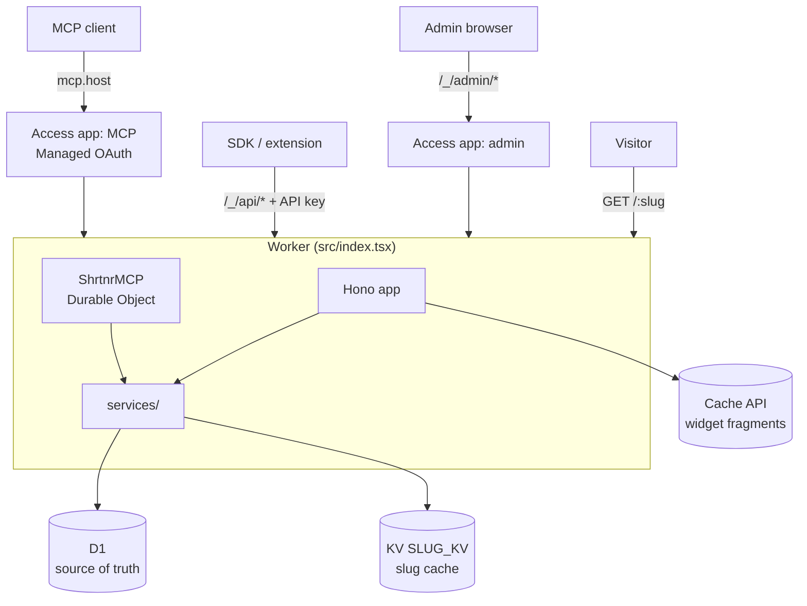
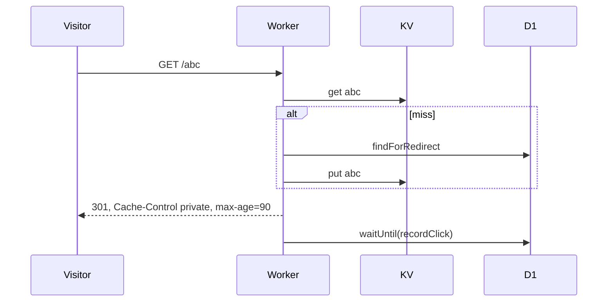

# Architecture

How the pieces connect. Code map: `code-architecture.md`. Rules: `code-rules.md`.

## One Worker, four surfaces

One Cloudflare Worker serves every surface. No second runtime, no separate API service.

| Surface | Entry | Caller | Identity from |
|---|---|---|---|
| Redirect | `/:slug` | anyone | none |
| Admin UI and admin API | `/_/admin/*` | browser | Cloudflare Access JWT (`ACCESS_AUD`) |
| Public API | `/_/api/*` | SDKs, extension, scripts | API key (`Authorization: Bearer sk_…`) |
| MCP | `mcp.<host>`, rewritten to `/_/mcp` | AI clients | Cloudflare Access Managed OAuth (`MCP_ACCESS_AUD`) |

All four call one service layer. Authorization rules live there once (`access-control.md`).

## Request routing

`fetch` in `src/index.tsx`, in order:

1. `ensureSchema()` unless the path is `/_/health` or `/_/setup`.
2. Host `mcp.*`: rewrite to `/_/mcp`, strip a leading `/mcp`.
3. `/_/mcp`: browser visit gets the landing page; otherwise verify identity, pass `email` as Durable Object props, hand to `ShrtnrMCP.serve()`.
4. `/.well-known/oauth-authorization-server`: metadata pointing at Access `/cdn-cgi/access/*`.
5. Everything else: the Hono app.

Hono order: health, setup, hashed assets, dev login, admin middleware, admin pages, widget route, admin API, public API, `/`, `/:slug`, 404.

## Identity

| Surface | Missing config | Unauthenticated |
|---|---|---|
| Admin | `ACCESS_AUD` unset: setup page, admin API 503 | page: 302 to `/`; admin API: 401 |
| MCP | `MCP_ACCESS_AUD` unset: 404 | 401 with `WWW-Authenticate` |
| Public API | n/a | 401 |

Dev mode (`DEV_MODE=true` and no `ACCESS_AUD`) takes identity from the `dev_identity` cookie (`/_/dev/login`), then `DEV_IDENTITY`, then `anonymous`. A configured `ACCESS_AUD` always wins.

An API key carries the identity of its issuer and a scope (`read`, `create`, or both). Scope is checked before ownership. The admin API applies no scope.

## Configuration

| Name | Kind | Purpose |
|---|---|---|
| `DB` | D1 binding | all data |
| `SLUG_KV` | KV binding | slug cache, widget cache versions, schema version |
| `MCP_OBJECT` | Durable Object | MCP sessions (`ShrtnrMCP`) |
| `ACCESS_AUD` | secret | admin Access audience tags, comma-separated |
| `MCP_ACCESS_AUD` | secret | MCP Access audience tag |
| `ACCESS_JWKS_URL` | secret | Access team certificates |
| `SHORT_ORIGIN` | var, optional | origin short URLs are built from |
| `FP_SALT` | secret, optional | visitor fingerprint salt |
| `DEV_MODE`, `DEV_IDENTITY` | `.dev.vars` only | local identity |

`wrangler.jsonc` carries no resource IDs. Wrangler provisions D1 and KV by binding name on first deploy.

## Redirect path

Disabled, expired or unknown: 404. The click (referrer, country, device, UTM, bot flag, self-referrer flag, fingerprint) is written after the response.

## Storage roles

| Store | Holds | Consistency |
|---|---|---|
| D1 | links, slugs, clicks, bundles, settings, API key hashes | source of truth |
| KV `SLUG_KV` | `slug → {url, disabled_at, expires_at}`; `wcache:ver:<identity>`; `schema:version` | eventually consistent; written by every slug-changing service call |
| Cache API | rendered widget fragments, 30 to 60 s TTL | per colo; key includes identity, language, filters, KV version |
| Durable Object storage | MCP session state | per session |

## Schema bootstrap

A Deploy to Cloudflare click provisions an empty D1. The Worker applies `migrations/*.sql` itself on first request, from the bundle `src/db/migrations.generated.ts`, using wrangler's `d1_migrations` table. Either path (Worker or `wrangler d1 migrations apply`) can run first.

On migration failure: no schema means 503 everywhere. Older schema present means redirects keep serving and operator routes get the 503 page. `/_/setup` reports status and retries.

## Clients outside the Worker

| Client | Path | Talks to |
|---|---|---|
| TypeScript SDK | `sdk/typescript/` | public API |
| Python SDK | `sdk/python/` | public API |
| Dart SDK | `sdk/dart/` | public API |
| Browser extension (Chrome, Firefox) | `browser-extensions/` | public API through the TypeScript SDK |

SDKs send `X-Client: sdk`; the API records `created_via` as `sdk`, else `api`. MCP records `mcp`, admin UI `app`. The OpenAPI document (`/_/api/openapi.json`) is the contract; each SDK records its hash (`release-automation.md`).

## Network boundaries

| From | To | Credential |
|---|---|---|
| Browser | Worker admin | `CF_Authorization` cookie / `Cf-Access-Jwt-Assertion` |
| SDK | Worker API | API key |
| MCP client | Access, then Worker | OAuth token issued by Access |
| Worker | Access JWKS | none |
| Worker | link target URL | none; `<title>` fetch for auto-label, public hosts only |
